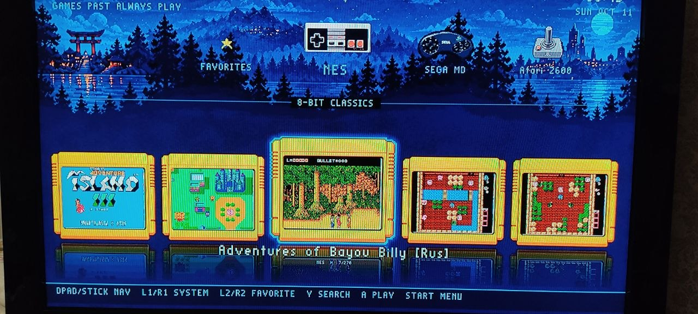
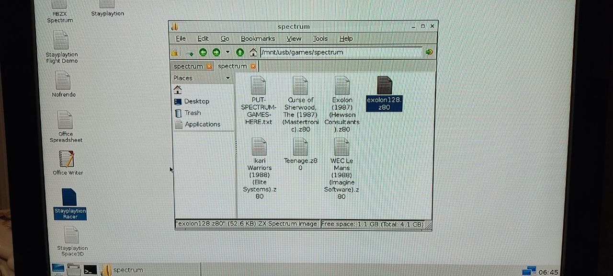

# H3531 Home Computer / StayPlaytion

**Как старый видеорегистратор постепенно превращается в домашний Linux-компьютер и игровую платформу**

[Публичный релиз v0.7](https://github.com/irman100/H3531/releases/tag/v0.7-fbzx-z80-demo) ·
[Ветка разработки](https://github.com/irman100/H3531/tree/feature/h3531-stage68-desktop-input-polish) ·
[История проекта](docs/articles/h3531-home-computer-ru.md)

H3531 начался с довольно простого вопроса: что ещё можно сделать со старой платой видеорегистратора, если внутри у неё полноценный ARM-процессор, Linux и видеовыход? Постепенно этот эксперимент вырос гораздо дальше первоначальной идеи. Сначала мы добились собственного изображения на HDMI и сделали простую компьютерную среду, затем добавили полноценный рабочий стол, игровую оболочку StayPlaytion, несколько эмуляторов и, наконец, начали переносить в собственный движок элементы мира **GTA Vice City**.

Это не история о том, как мы просто собрали несколько готовых программ. Почти на каждом этапе приходилось разбираться с особенностями старого HiSilicon, писать собственные связующие компоненты, адаптировать чужие проекты под ARMv7 и проверять результат на настоящей плате.

> **Состояние на 2 ноября 2026 года.** Публичный USB Kit v0.7 — это первый воспроизводимый релиз проекта. Более поздние Desktop, StayPlaytion, новые эмуляторные порты и Racer развиваются в отдельной ветке и пока не входят в архив v0.7. Ниже мы рассказываем о развитии всей платформы, а не утверждаем, что все новые компоненты уже выпущены единым установочным комплектом.

## С чего всё началось

В основе проекта — DVR-плата **AHB70XXT16-3531 V2.01** с процессором **HiSilicon Hi3531**. Изначально она предназначалась для видеонаблюдения, но у неё есть всё необходимое для небольшого самостоятельного компьютера: два ядра ARM Cortex-A9, оперативная память, USB, Ethernet и видеовывод.

Первой большой задачей было понять, как устроена заводская система и как получить собственное изображение, не полагаясь на штатное DVR-приложение. Мы разобрались с видеоподсистемой HiSilicon и подняли собственный вывод через MPP, VO и HIFB непосредственно на HDMI.

С самого начала мы выбрали осторожный способ экспериментов: собственная система запускается с USB в RAM, а заводская SPI Flash остаётся нетронутой. Это позволяло многократно менять Linux-окружение и программы, не превращая каждый эксперимент в риск для исходной прошивки.

## Первая компьютерная среда: Monitor, FILES и BASIC

Когда изображение на экране заработало, появилась первая собственная оболочка — **H3531 Monitor**. Вначале это был простой интерфейс, из которого можно было перейти в shell и выполнять команды. Затем добавились файловый браузер **FILES**, работа с USB-накопителями, клавиатурой и мышью, история команд и запуск программ.

Отдельное направление занял BASIC. Мы добавили несколько реализаций, в том числе Tiny BASIC, Bywater BASIC и Matrix Brandy BASIC VI. Для графических программ появился собственный SDL 1.2 backend, который приспосабливает привычный программный интерфейс SDL к framebuffer платы.

Так H3531 перестал быть просто экраном с командной строкой. На нём уже можно было работать с файлами, запускать программы, писать и выполнять BASIC-код и проверять собственные графические приложения.

Первым большим экспериментом с эмуляцией стал **FBZX 3.1.0** — эмулятор ZX Spectrum. Мы адаптировали его под ARMv7 и наш видеовывод, а затем связали с FILES: можно было выбрать собственный Z80 snapshot и запустить его прямо из файловой среды. Для нас это был важный момент: стало понятно, что H3531 способен запускать не только наши небольшие программы, но и достаточно сложное стороннее программное обеспечение.

## Потом мы сделали Desktop — и изменили сам принцип работы системы

Поначалу компьютер работал по довольно простой схеме: Monitor запускал программу, программа получала экран, а после её завершения оболочку приходилось поднимать снова. Для первых опытов это подходило, но для обычного компьютера такая модель была неудобной.

Поэтому следующим большим шагом стал **постоянный Linux Desktop**. Мы перешли к X11-сессии на базе LXDE: с оконным менеджером Openbox, файловым менеджером PCManFM, панелью LXPanel и терминалом LXTerminal. Теперь система должна оставаться в одной рабочей сессии, а приложения могут открываться в обычных окнах, а не каждый раз заменять собой всю оболочку.

При этом мы не забыли старые программы, которым нужен прямой доступ к framebuffer. Для них появился **Native App Bridge**. Он временно передаёт такому приложению управление экраном и устройствами ввода, приостанавливая отрисовку Desktop, а после завершения приложения возвращает прежнюю графическую сессию. То есть старые полноэкранные программы и новый оконный рабочий стол могут сосуществовать в одной системе.

Появилась и более общая система описания приложений: манифесты сообщают, что именно установлено, как это запускать и какие типы файлов программа умеет открывать. Благодаря этому H3531 постепенно становится не набором разрозненных скриптов, а нормальной Linux-средой с приложениями и связями между ними.

## Следующим шагом стала StayPlaytion — единый игровой центр

После появления Desktop захотелось сделать ещё одну вещь: чтобы для запуска игр не приходилось каждый раз открывать файловый менеджер, искать ROM, вспоминать нужный эмулятор и отдельно настраивать управление.

Так появилась **StayPlaytion** — наша игровая оболочка. Важно правильно понимать её роль: StayPlaytion сама по себе не является одним большим эмулятором. Это единый игровой центр, который показывает доступные игровые системы и игры, а для запуска использует соответствующие эмуляторы и программные ядра.

Внутри мы постепенно собрали библиотеку систем, карусель игровых карточек и обложек, выбор игры, избранное и игровые настройки. Из оболочки можно перейти к запуску игры, открыть меню системы и вернуться обратно. Мы старались сделать интерфейс похожим на самостоятельную игровую приставку, а не на технический список файлов.

Отдельной большой работой стало управление. Мы добавили мастер настройки контроллера: он помогает определить крестовину, кнопки, оба аналоговых стика, нажатия L3/R3, плечевые кнопки и триггеры. Появились настраиваемые горячие комбинации для вызова меню RetroArch, сохранения и загрузки состояния, перемотки и ускорения. Профиль управления сохраняется в стандартном формате RetroArch, поэтому StayPlaytion и сам RetroArch используют одну и ту же конфигурацию контроллера.

Именно здесь проект стал похож на игровую платформу: пользователь выбирает систему и игру в одном интерфейсе, а разные эмуляторы становятся внутренними инструментами этой среды.

## Какие эмуляторы и приложения мы добавили

Мы не стали пытаться поместить всю эмуляцию в одну программу. У разных систем разные требования, поэтому в проекте используются как отдельные порты, так и RetroArch с подключаемыми libretro-ядрами.

- **FBZX 3.1.0** — ZX Spectrum. Он умеет работать как X11-приложение и как программа с прямым framebuffer-доступом.
- **Nofrendo v11.1** — Nintendo Entertainment System. Для него мы адаптировали видеовывод и аудио под HiSilicon.
- **RetroArch** — общий frontend для нескольких libretro-ядер. В экспериментальной линии есть FCEUmm для NES, PicoDrive для Mega Drive/Genesis, PCSX-ReARMed для PlayStation, Stella 2014 для Atari 2600, а также отдельные работы с Snes9x 2005 для SNES и gpSP для Game Boy Advance.

У разных ядер разная степень готовности и разная производительность. Сам факт сборки ещё не означает, что конкретная игра работает идеально на реальном Hi3531. Особенно внимательно приходится подходить к тяжёлым системам: у платы всего два Cortex-A9 и нет отдельного современного 3D GPU.

Кроме эмуляторов мы портировали и собирали нативные ARM-приложения. Среди направлений — SIAG Office, Space3D, Flight Core и другие графические эксперименты. Это важно для идеи проекта: H3531 должен быть не только игровой приставкой, но и небольшим компьютером, на котором можно запускать разные типы программ.

## А потом мы взялись за GTA Vice City

Самым амбициозным направлением стал собственный **3D Racer** и импорт ресурсов мира **GTA Vice City**.

Здесь мы не пошли по пути простого копирования всей reVC или попытки запустить современную версию игры целиком. Вместо этого мы начали разбирать форматы и механизмы Vice City и переносить необходимые части в отдельный компактный движок, рассчитанный на возможности Hi3531.

Мы сделали локальные инструменты импорта игровых данных: они разбирают размещение объектов и мира, модели, текстуры и collision-ресурсы из установленной пользователем копии Vice City. Затем мир собирается в страницы, чтобы не держать всю карту в памяти одновременно, а подгружать нужные области по мере движения автомобиля.

Постепенно к этому добавились уровни детализации объектов (LOD), обработка коллизий, подвеска и силы на отдельных колёсах, а также использование игровых параметров автомобиля и свойств поверхностей. Отдельно развивается аудиопуть через штатную аудиосистему HiSilicon.

По сути, мы начали строить собственную техническую основу для портирования элементов GTA Vice City на необычную и довольно ограниченную платформу. Это **экспериментальный проект**, а не законченный порт всей Vice City: ещё остаются задачи по производительности, физике, управлению и полноценному игровому циклу. Но сам факт, что на старой DVR-плате уже можно запускать собственную 3D-сцену с автомобилем и импортированным окружением, стал для нас очень большим шагом.

Мы не распространяем в репозитории оригинальные модели, текстуры, музыку, ROM или другие проприетарные игровые данные. Импортёр рассчитан на локальную работу с собственной копией игры пользователя; производные игровые ресурсы остаются локальными.

## Как всё это соединяется

Если упростить, сейчас идея платформы выглядит так:

- в основе находится Linux и собственный системный слой H3531;
- поверх него работает постоянный Desktop;
- обычные Linux-приложения открываются в окнах;
- старые полноэкранные программы получают экран через Native App Bridge;
- StayPlaytion служит отдельным игровым центром;
- эмуляторы и libretro-ядра запускаются как отдельные компоненты;
- Racer развивается как собственное нативное 3D-приложение.

Мы хотим сохранить именно эту архитектуру: один компьютер, один системный фундамент и разные приложения поверх него — без необходимости превращать каждое новое направление в отдельную прошивку.

## Фотографии проекта

Ниже пока собраны материалы, которые уже есть в нашей библиотеке. Это временная подборка: три фотографии **GTA.jpg**, **stateplaytion.jpg** и **desktop.jpg** будут заменены на новые актуальные снимки с соответствующими названиями. Пути к файлам в README останутся прежними — достаточно будет заменить сами изображения.

  
  
  

Концептуальная иллюстрация StayPlaytion

Это изображение было сгенерировано как визуальная концепция библиотеки ретро-игр. Оно помогает показать направление интерфейса, но **не является фотографией или снимком реально запущенной версии**.

  

Старые фотографии Monitor, FILES, BASIC, FBZX и предыдущие снимки Racer сохранены в [галерее проекта](docs/images/README.md). По мере появления новых фотографий мы будем заменять временные иллюстрации реальными снимками актуальной сборки.

## Что уже опубликовано, а что ещё развивается

Первый публичный комплект **H3531 Home Computer USB Kit v0.7** появился 11 сентября 2026 года. Он показывает раннюю, воспроизводимую часть проекта: безопасный USB/RAM-запуск, Linux 3.0.8, Monitor, FILES, BASIC, SDL backend и экспериментальный FBZX.

После этого проект сильно вырос. Постоянный Desktop, StayPlaytion, расширенные порты эмуляторов и Racer находятся в отдельной ветке разработки:

[feature/h3531-stage68-desktop-input-polish](https://github.com/irman100/H3531/tree/feature/h3531-stage68-desktop-input-polish)

Эти новые компоненты не следует путать с содержимым старого архива v0.7. Мы продолжаем отдельно проверять сборки, интеграцию и поведение на настоящей плате; статус разных приложений и эмуляторных ядер неодинаков.

### Скачать первый публичный комплект

- [H3531 Home Computer USB Kit v0.7](https://github.com/irman100/H3531/releases/download/v0.7-fbzx-z80-demo/H3531-Home-Computer-USB-Kit-v0.7-fbzx-z80.zip)
- [Страница релиза и контрольная сумма](https://github.com/irman100/H3531/releases/tag/v0.7-fbzx-z80-demo)
- [Инструкция быстрого запуска](docs/quickstart-v0.7-fbzx-z80-ru.md)
- [Техническая документация платы](docs/AHB70XXT16-3531_Hi3531_Technical_Documentation_RU_v3.docx)

## Платформа и ограничения

| Компонент | Значение |
|---|---|
| Плата | AHB70XXT16-3531 V2.01 |
| SoC | HiSilicon Hi3531 |
| CPU | 2 × ARM Cortex-A9 / ARMv7 |
| ОС | Linux 3.0.8 |
| Видео | HIFB / HDMI, 1280×720, 16 bit |
| 3D в Racer | Программный CPU rasterizer |
| Аудио | Штатный HiSilicon AO backend |
| ARM ABI | softfp / VFPv3-D16 |

У этой платы есть важные ограничения. Мы не рассчитываем на наличие отдельного современного 3D GPU и не используем NEON-инструкции: сборки должны соответствовать фактическим возможностям Cortex-A9. Поэтому для каждого порта приходится отдельно искать баланс между совместимостью, качеством изображения и скоростью.

Базовое правило безопасности не меняется: экспериментальная система загружается с USB/RAM. Мы не используем saveenv, не заменяем заводской U-Boot и не записываем экспериментальные образы в SPI Flash.

## Права и лицензии

- H3531 — независимый исследовательский проект, не связанный с HiSilicon или производителями исходного DVR.
- Проект не одобрен и не связан с Rockstar Games.
- Игровые ROM, BIOS, оригинальные ресурсы GTA Vice City и другие проприетарные материалы не распространяются этим репозиторием.
- Для локального импорта Vice City пользователь должен самостоятельно располагать собственной копией игры и соблюдать применимые условия её использования.
- В репозитории пока нет файла LICENSE. Публичная доступность исходников сама по себе не означает предоставления лицензии на их повторное использование.

## English summary

H3531 Home Computer is an experiment that turns an older HiSilicon Hi3531 DVR board into an ARM Linux computer. It began with a custom Monitor, file browser, BASIC interpreters and an SDL backend. Later we added a persistent X11/LXDE desktop, a native-app bridge for legacy framebuffer applications, and StayPlaytion — a unified gaming frontend that launches separate emulators and libretro cores.

The newest and most ambitious direction is a native 3D Racer with a local importer for GTA Vice City world assets. It uses paged world data, streaming, object LOD and custom vehicle/collision work. This is not a finished full Vice City port. The public v0.7 USB kit remains the first reproducible release; the later Desktop, StayPlaytion and Racer work lives on the development branch and is not included in that archive.
