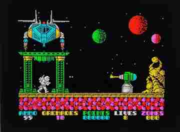

<!-- H3531 bilingual project page. English first, Russian below. -->

# H3531 Home Computer & StayPlaytion

[English](#english) · [Русский](#russian)

H3531 is an experimental home-computer and retro-gaming platform built around the HiSilicon Hi3531 board originally used in DVR equipment. The project explores how far this hardware can be repurposed: from a Linux desktop and classic command-line tools to native framebuffer applications, emulators and a game-oriented interface.

This is a community hardware/software project, not an official HiSilicon product and not an official port of any commercial game.

## At a glance

- **Hardware:** HiSilicon Hi3531 / ARM-based DVR board.
- **System:** a customized Linux environment with an X11 desktop.
- **Desktop components:** LXDE, Openbox, PCManFM, LXPanel and LXTerminal.
- **Native applications:** Monitor, FILES, BASIC and SDL experiments.
- **Retro gaming:** FBZX for ZX Spectrum and additional experimental emulator ports.
- **Game interface:** StayPlaytion, a frontend for browsing and launching available games.

## What the photos show

<table>
  <tr>
    <td width="50%">
      
      
<em>ZX Spectrum: Exolon running in FBZX.</em>

    </td>
    <td width="50%">
      
      
<em>StayPlaytion — the game browser and interface.</em>

    </td>
  </tr>
  <tr>
    <td>
      
      
<em>GTA experiment — scene 1.</em>

    </td>
    <td>
      
      
<em>GTA experiment — scene 2.</em>

    </td>
  </tr>
</table>

<em>Linux desktop and project files on the H3531 board.</em>

## Desktop and applications

The project turns the board into a small Linux computer. The desktop environment provides a graphical workspace, while the native application experiments explore direct access to the board's display and input facilities.

- **Monitor** — a system and hardware-oriented application.
- **FILES** — a lightweight file-management interface.
- **BASIC** — experiments with classic BASIC environments.
- **SDL and native app bridge** — a route for running graphical applications that do not depend on a full desktop window manager.

The exact availability of individual applications depends on the build and the current development state.

## Retro gaming and StayPlaytion

FBZX provides a ZX Spectrum environment; the Exolon photo above is a real project capture. Other emulator ports and compatibility experiments are at different stages of maturity. Performance and compatibility depend on the emulator, game and board configuration.

StayPlaytion is the project's game-oriented frontend. It is an interface for launching available content, not an emulator by itself.

The repository also contains early 3D and GTA-related experiments. These are prototypes and experiments, not a complete Grand Theft Auto: Vice City port. The repository does not include commercial game data or assets.

## Download

The current public demo is attached to the **StayPlaytion** GitHub prerelease:

- [Download SP.rar](https://github.com/irman100/H3531/releases/download/StayPlaytion/SP.rar)
- [Open the StayPlaytion release page](https://github.com/irman100/H3531/releases/tag/StayPlaytion)

The published asset is a RAR archive (179,238,987 bytes). GitHub reports the uploaded asset; the archive's full contents and extraction integrity have not been independently verified here. The historical v0.7 quick-start guide applies to the old v0.7 package, not automatically to SP.rar.

The repository's development branch may contain newer experiments that are not necessarily included in the public release: [development branch](https://github.com/irman100/H3531/tree/feature/h3531-stage68-desktop-input-polish).

## Project status and contributions

H3531 is an experimental platform. Features can be incomplete, hardware-specific or under active development. Please check the relevant documentation and release notes before attempting to reproduce a particular setup.

Issues, reproducible test results, hardware notes and focused pull requests are welcome.

---

# Русская версия

H3531 начался с довольно простого вопроса: что ещё можно сделать со старой платой видеорегистратора, если внутри у неё полноценный ARM-процессор, Linux и видеовыход? Постепенно этот эксперимент вырос гораздо дальше первоначальной идеи. Сначала мы добились собственного изображения на HDMI и сделали простую компьютерную среду, затем добавили полноценный рабочий стол, игровую оболочку StayPlaytion, несколько эмуляторов и, наконец, начали переносить в собственный движок элементы мира **GTA Vice City**.

Это не история о том, как мы просто собрали несколько готовых программ. Почти на каждом этапе приходилось разбираться с особенностями старого HiSilicon, писать собственные связующие компоненты, адаптировать чужие проекты под ARMv7 и проверять результат на настоящей плате.

> **Состояние на 2 ноября 2026 года.** В GitHub Releases опубликован отдельный релиз **StayPlaytion** с файлом `SP.rar` (179 238 987 байт, формат RAR). Старый тег `v0.7-fbzx-z80-demo` и ссылка на прежний USB Kit больше не доступны. Новый файл уже загружен в GitHub Releases, но его внутреннее содержимое здесь не объявляется проверенным: описание ниже рассказывает о развитии платформы и не заменяет проверку конкретной сборки на устройстве.

## С чего всё началось

В основе проекта — DVR-плата **AHB70XXT16-3531 V2.01** с процессором **HiSilicon Hi3531**. Изначально она предназначалась для видеонаблюдения, но у неё есть всё необходимое для небольшого самостоятельного компьютера: два ядра ARM Cortex-A9, оперативная память, USB, Ethernet и видеовывод.

Первой большой задачей было понять, как устроена заводская система и как получить собственное изображение, не полагаясь на штатное DVR-приложение. Мы разобрались с видеоподсистемой HiSilicon и подняли собственный вывод через MPP, VO и HIFB непосредственно на HDMI.

С самого начала мы выбрали осторожный способ экспериментов: собственная система запускается с USB в RAM, а заводская SPI Flash остаётся нетронутой. Это позволяло многократно менять Linux-окружение и программы, не превращая каждый эксперимент в риск для исходной прошивки.

## Первая компьютерная среда: Monitor, FILES и BASIC

Когда изображение на экране заработало, появилась первая собственная оболочка — **H3531 Monitor**. Вначале это был простой интерфейс, из которого можно было перейти в shell и выполнять команды. Затем добавились файловый браузер **FILES**, работа с USB-накопителями, клавиатурой и мышью, история команд и запуск программ.

Отдельное направление занял BASIC. Мы добавили несколько реализаций, в том числе Tiny BASIC, Bywater BASIC и Matrix Brandy BASIC VI. Для графических программ появился собственный SDL 1.2 backend, который приспосабливает привычный программный интерфейс SDL к framebuffer платы.

Так H3531 перестал быть просто экраном с командной строкой. На нём уже можно было работать с файлами, запускать программы, писать и выполнять BASIC-код и проверять собственные графические приложения.

Первым большим экспериментом с эмуляцией стал **FBZX 3.1.0** — эмулятор ZX Spectrum. Мы адаптировали его под ARMv7 и наш видеовывод, а затем связали с FILES: можно было выбрать собственный Z80 snapshot и запустить его прямо из файловой среды. Для нас это был важный момент: стало понятно, что H3531 способен запускать не только наши небольшие программы, но и достаточно сложное стороннее программное обеспечение.

### ZX Spectrum: отдельное направление для поклонников 8-битной классики

ZX Spectrum — британский 8-битный домашний компьютер Sinclair Research, представленный в 1982 году. Его доступность и большая библиотека игр помогли сформировать целое поколение разработчиков и игроков. Поэтому Spectrum в H3531 — не случайный пункт среди эмуляторов, а самостоятельная часть ретро-направления проекта. [National Videogame Museum: ZX Spectrum](https://thenvm.org/objects/zx-spectrum/).

Для запуска Spectrum-программ используется **FBZX 3.1.0**. Эмулятор адаптирован под ARMv7 и графический вывод H3531; образы и snapshot-файлы, в том числе `.Z80`, можно выбирать из файловой среды. В фотоподборке **Spectrum.jpg** показана игра **Exolon** — аркадный экшен Hewson Consultants, выпущенный для ZX Spectrum в 1987 году и рассчитанный на модели 48K/128K. [World of Spectrum: Exolon](https://worldofspectrum.net/item/0001686/).

Этот пример наглядно показывает назначение FBZX: H3531 может выступать не только как Linux-компьютер, но и как машина для запуска классического программного наследия Spectrum.

## Потом мы сделали Desktop — и изменили сам принцип работы системы

Поначалу компьютер работал по довольно простой схеме: Monitor запускал программу, программа получала экран, а после её завершения оболочку приходилось поднимать снова. Для первых опытов это подходило, но для обычного компьютера такая модель была неудобной.

Поэтому следующим большим шагом стал **постоянный Linux Desktop**. Мы перешли к X11-сессии на базе LXDE: с оконным менеджером Openbox, файловым менеджером PCManFM, панелью LXPanel и терминалом LXTerminal. Теперь система должна оставаться в одной рабочей сессии, а приложения могут открываться в обычных окнах, а не каждый раз заменять собой всю оболочку.

При этом мы не забыли старые программы, которым нужен прямой доступ к framebuffer. Для них появился **Native App Bridge**. Он временно передаёт такому приложению управление экраном и устройствами ввода, приостанавливая отрисовку Desktop, а после завершения приложения возвращает прежнюю графическую сессию. То есть старые полноэкранные программы и новый оконный рабочий стол могут сосуществовать в одной системе.

Появилась и более общая система описания приложений: манифесты сообщают, что именно установлено, как это запускать и какие типы файлов программа умеет открывать. Благодаря этому H3531 постепенно становится не набором разрозненных скриптов, а нормальной Linux-средой с приложениями и связями между ними.

## Следующим шагом стала StayPlaytion — единый игровой центр

После появления Desktop захотелось сделать ещё одну вещь: чтобы для запуска игр не приходилось каждый раз открывать файловый менеджер, искать ROM, вспоминать нужный эмулятор и отдельно настраивать управление.

Так появилась **StayPlaytion** — наша игровая оболочка. Важно правильно понимать её роль: StayPlaytion сама по себе не является одним большим эмулятором. Это единый игровой центр, который показывает доступные игровые системы и игры, а для запуска использует соответствующие эмуляторы и программные ядра.

Внутри мы постепенно собрали библиотеку систем, карусель игровых карточек и обложек, выбор игры, избранное и игровые настройки. Из оболочки можно перейти к запуску игры, открыть меню системы и вернуться обратно. Мы старались сделать интерфейс похожим на самостоятельную игровую приставку, а не на технический список файлов.

Отдельной большой работой стало управление. Мы добавили мастер настройки контроллера: он помогает определить крестовину, кнопки, оба аналоговых стика, нажатия L3/R3, плечевые кнопки и триггеры. Появились настраиваемые горячие комбинации для вызова меню RetroArch, сохранения и загрузки состояния, перемотки и ускорения. Профиль управления сохраняется в стандартном формате RetroArch, поэтому StayPlaytion и сам RetroArch используют одну и ту же конфигурацию контроллера.

Именно здесь проект стал похож на игровую платформу: пользователь выбирает систему и игру в одном интерфейсе, а разные эмуляторы становятся внутренними инструментами этой среды.

## Какие эмуляторы и приложения мы добавили

Мы не стали пытаться поместить всю эмуляцию в одну программу. У разных систем разные требования, поэтому в проекте используются как отдельные порты, так и RetroArch с подключаемыми libretro-ядрами.

- **FBZX 3.1.0** — ZX Spectrum. Он умеет работать как X11-приложение и как программа с прямым framebuffer-доступом.
- **Nofrendo v11.1** — Nintendo Entertainment System. Для него мы адаптировали видеовывод и аудио под HiSilicon.
- **RetroArch** — общий frontend для нескольких libretro-ядер. В экспериментальной линии есть FCEUmm для NES, PicoDrive для Mega Drive/Genesis, PCSX-ReARMed для PlayStation, Stella 2014 для Atari 2600, а также отдельные работы с Snes9x 2005 для SNES и gpSP для Game Boy Advance.

У разных ядер разная степень готовности и разная производительность. Сам факт сборки ещё не означает, что конкретная игра работает идеально на реальном Hi3531. Особенно внимательно приходится подходить к тяжёлым системам: у платы всего два Cortex-A9 и нет отдельного современного 3D GPU.

Кроме эмуляторов мы портировали и собирали нативные ARM-приложения. Среди направлений — SIAG Office, Space3D, Flight Core и другие графические эксперименты. Это важно для идеи проекта: H3531 должен быть не только игровой приставкой, но и небольшим компьютером, на котором можно запускать разные типы программ.

## А потом мы взялись за GTA Vice City

Самым амбициозным направлением стал собственный **3D Racer** и импорт ресурсов мира **GTA Vice City**.

Здесь мы не пошли по пути простого копирования всей reVC или попытки запустить современную версию игры целиком. Вместо этого мы начали разбирать форматы и механизмы Vice City и переносить необходимые части в отдельный компактный движок, рассчитанный на возможности Hi3531.

Мы сделали локальные инструменты импорта игровых данных: они разбирают размещение объектов и мира, модели, текстуры и collision-ресурсы из установленной пользователем копии Vice City. Затем мир собирается в страницы, чтобы не держать всю карту в памяти одновременно, а подгружать нужные области по мере движения автомобиля.

Постепенно к этому добавились уровни детализации объектов (LOD), обработка коллизий, подвеска и силы на отдельных колёсах, а также использование игровых параметров автомобиля и свойств поверхностей. Отдельно развивается аудиопуть через штатную аудиосистему HiSilicon.

По сути, мы начали строить собственную техническую основу для портирования элементов GTA Vice City на необычную и довольно ограниченную платформу. Это **экспериментальный проект**, а не законченный порт всей Vice City: ещё остаются задачи по производительности, физике, управлению и полноценному игровому циклу. Но сам факт, что на старой DVR-плате уже можно запускать собственную 3D-сцену с автомобилем и импортированным окружением, стал для нас очень большим шагом.

Мы не распространяем в репозитории оригинальные модели, текстуры, музыку, ROM или другие проприетарные игровые данные. Импортёр рассчитан на локальную работу с собственной копией игры пользователя; производные игровые ресурсы остаются локальными.

## Как всё это соединяется

Если упростить, сейчас идея платформы выглядит так:

- в основе находится Linux и собственный системный слой H3531;
- поверх него работает постоянный Desktop;
- обычные Linux-приложения открываются в окнах;
- старые полноэкранные программы получают экран через Native App Bridge;
- StayPlaytion служит отдельным игровым центром;
- эмуляторы и libretro-ядра запускаются как отдельные компоненты;
- Racer развивается как собственное нативное 3D-приложение.

Мы хотим сохранить именно эту архитектуру: один компьютер, один системный фундамент и разные приложения поверх него — без необходимости превращать каждое новое направление в отдельную прошивку.

## Фотографии проекта

<table>
  <tr>
    <td width="50%">
      
      
<em>ZX Spectrum: Exolon работает в FBZX.</em>

    </td>
    <td width="50%">
      
      
<em>StayPlaytion — игровая оболочка и выбор игр.</em>

    </td>
  </tr>
  <tr>
    <td>
      
      
<em>GTA — экспериментальная сцена 1.</em>

    </td>
    <td>
      
      
<em>GTA — экспериментальная сцена 2.</em>

    </td>
  </tr>
</table>

<em>Рабочий стол Linux и файлы проекта на плате H3531.</em>

## Что уже опубликовано, а что ещё развивается

Первый публичный комплект **H3531 Home Computer USB Kit v0.7** был опубликован 11 сентября 2026 года и представлял раннюю, воспроизводимую часть проекта. Его прежний тег `v0.7-fbzx-z80-demo` и старый ZIP больше не доступны по опубликованным ранее адресам.

Сейчас в Releases размещён отдельный архив **StayPlaytion — `SP.rar`**. Это RAR-файл, загруженный 2 ноября 2026 года; он не должен называться ZIP и не должен смешиваться с исторической инструкцией v0.7. GitHub показывает для него статус `uploaded` и SHA-256 `7482100243c552556f08bb8332f4fa65db696ebed73dc799ce0c290314fbebe1`.

Исходный код более поздних Desktop, GameFront, дополнительных портов эмуляторов и Racer продолжает развиваться в отдельной ветке. Наличие компонента в ветке само по себе не означает, что он целиком включён в бинарный архив `SP.rar`:

[feature/h3531-stage68-desktop-input-polish](https://github.com/irman100/H3531/tree/feature/h3531-stage68-desktop-input-polish)

Эти новые компоненты не следует путать с содержимым старого архива v0.7. Мы продолжаем отдельно проверять сборки, интеграцию и поведение на настоящей плате; статус разных приложений и эмуляторных ядер неодинаков.

### Скачать текущий публичный архив

- [Скачать StayPlaytion — SP.rar (RAR)](https://github.com/irman100/H3531/releases/download/StayPlaytion/SP.rar)
- [Страница релиза StayPlaytion](https://github.com/irman100/H3531/releases/tag/StayPlaytion)
- SHA-256 файла — `7482100243c552556f08bb8332f4fa65db696ebed73dc799ce0c290314fbebe1` (значение, опубликованное GitHub Releases)
- [Историческая инструкция быстрого запуска v0.7](docs/quickstart-v0.7-fbzx-z80-ru.md) — относится к прежнему USB Kit, а не подтверждённо к `SP.rar`
- [Техническая документация платы](docs/AHB70XXT16-3531_Hi3531_Technical_Documentation_RU_v3.docx)

## Платформа и ограничения

| Компонент | Значение |
|---|---|
| Плата | AHB70XXT16-3531 V2.01 |
| SoC | HiSilicon Hi3531 |
| CPU | 2 × ARM Cortex-A9 / ARMv7 |
| ОС | Linux 3.0.8 |
| Видео | HIFB / HDMI, 1280×720, 16 bit |
| 3D в Racer | Программный CPU rasterizer |
| Аудио | Штатный HiSilicon AO backend |
| ARM ABI | softfp / VFPv3-D16 |

У этой платы есть важные ограничения. Мы не рассчитываем на наличие отдельного современного 3D GPU и не используем NEON-инструкции: сборки должны соответствовать фактическим возможностям Cortex-A9. Поэтому для каждого порта приходится отдельно искать баланс между совместимостью, качеством изображения и скоростью.

Базовое правило безопасности не меняется: экспериментальная система загружается с USB/RAM. Мы не используем saveenv, не заменяем заводской U-Boot и не записываем экспериментальные образы в SPI Flash.

## Права и лицензии

- H3531 — независимый исследовательский проект, не связанный с HiSilicon или производителями исходного DVR.
- Проект не одобрен и не связан с Rockstar Games.
- Игровые ROM, BIOS, оригинальные ресурсы GTA Vice City и другие проприетарные материалы не распространяются этим репозиторием.
- Для локального импорта Vice City пользователь должен самостоятельно располагать собственной копией игры и соблюдать применимые условия её использования.
- В репозитории пока нет файла LICENSE. Публичная доступность исходников сама по себе не означает предоставления лицензии на их повторное использование.
