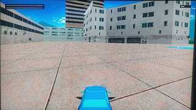
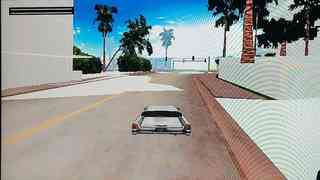

# H3531 Home Computer / Stayplaytion

**Экспериментальная домашняя Linux- и gaming-платформа на базе HiSilicon Hi3531**

[Публичный demo v0.7](https://github.com/irman100/H3531/releases/tag/v0.7-fbzx-z80-demo) ·
[Актуальная ветка разработки](https://github.com/irman100/H3531/tree/feature/h3531-stage68-desktop-input-polish) ·
[История проекта](docs/articles/h3531-home-computer-ru.md)

H3531 Home Computer превращает DVR-плату **AHB70XXT16-3531 V2.01** с SoC HiSilicon Hi3531 в экспериментальный ARM Linux-компьютер: с собственным видеовыводом, файловой средой, постоянным Desktop, игровым интерфейсом, эмуляторами, нативными приложениями и отдельным 3D Racer.

> **Состояние публикации на 1 ноября 2026.** Последний публичный prerelease — **v0.7 от 11 сентября 2026 года**. Он остаётся стартовым комплектом Monitor / FILES / BASIC / FBZX. Более поздняя разработка — постоянный LXDE Desktop, GameFront, новые порты и Racer — находится в ветке [feature/h3531-stage68-desktop-input-polish](https://github.com/irman100/H3531/tree/feature/h3531-stage68-desktop-input-polish) и не входит в архив v0.7. GitHub Actions #584 для этой ветки завершился успешно 8 октября, но зелёный CI не заменяет аппаратную проверку каждой функции.

## Что появилось после первой публикации

### Постоянный Linux Desktop

- Постоянная X11/LXDE-сессия вместо модели «одно полноэкранное приложение — перезапуск Monitor».
- Openbox, PCManFM и LXPanel; автоматическое поднятие сети/DHCP.
- FBZX может работать в обычном X11-окне, не закрывая Desktop.
- Native App Bridge временно передаёт прямой framebuffer старым приложениям, сохраняя живую Desktop-сессию.
- APPINFO-манифесты описывают приложения, режим запуска и файловые ассоциации.
- Добавлены сохранение состояния Desktop, USB hot-plug и согласование владения клавиатурой/мышью.

Подробности: [Stage 6.6A — Persistent Desktop](ports/stage66a/README.md).

### GameFront и управление

Отдельная игровая оболочка с библиотекой систем и игр, медиакарточками, поиском, избранным, настройками управления, мастером настройки контроллера, чтением осей и горячими клавишами. Разработка дошла до серии Stage 4.48.

GameFront — frontend поверх приложений и эмуляторов, а не замена Desktop или файловой системы.

Подробности: [GameFront README](ports/frontend/README.md) · [исходники в development branch](https://github.com/irman100/H3531/tree/feature/h3531-stage68-desktop-input-polish/ports/frontend).

### Эмуляторы и приложения

В ветке разработки находятся:

- **FBZX 3.1.0** — ZX Spectrum, X11-режим и нативный framebuffer fallback.
- **Nofrendo v11.1** — NES, отдельный ARM/HIFB video path и аудиобэкенд платы.
- **RetroArch** — портирование libretro engines/cores, включая FCEUmm, PicoDrive, PCSX-ReARMed и Stella 2014; совместимость и скорость зависят от ядра.
- **SIAG Office** — сборка офисного пакета под ARM.
- Нативные графические эксперименты, включая Space3D и Flight Core.

Сборка и CI не означают, что каждое приложение одинаково хорошо проверено на реальном устройстве.

### Нативный 3D Racer и импорт мира Vice City

Самое крупное новое направление — собственный лёгкий 3D Racer для Hi3531. Это **не полный порт reVC**: нужные принципы GTA переносятся в отдельный компактный движок для Cortex-A9 и программного rasterizer.

В development branch реализованы:

- локальный импорт ресурсов Vice City: IDE/IPL, DFF, TXD/TXDP и COL;
- сборка мира в страницы и потоковая загрузка областей вокруг автомобиля;
- объектный LOD с сохранением GTA atomic LOD и дистанций;
- форматы VFW1/VCO2 и object-lod-v4;
- собственная обработка коллизий, подвески и сил от четырёх колёс;
- импорт характеристик из handling.cfg и поверхностей из surface.dat;
- HiSilicon AO audio backend, локальный импорт SFX и радиостанций из пользовательской установки игры;
- CPU-оптимизации: object frustum culling, кеши преобразований/проекций, dual-core raster и scanline-span raster.

**Racer остаётся экспериментальным.** Управление, физика автомобиля и производительность требуют дальнейшей аппаратной доводки; текущую сборку нельзя представлять как законченный или полностью играбельный порт Vice City. Подробности и ограничения: [ports/racer/README.md](ports/racer/README.md).

### Firmware и безопасная загрузка

Основной принцип сохранён: экспериментальная система развивается через USB/RAM. Не требуется заменять заводской U-Boot или записывать экспериментальные образы в SPI Flash. Stage 6.8 описывает отдельный firmware/POST prototype и внешний OS rootfs, но это пока не завершённая замена загрузочной цепочки.

## Фотографии с устройства

Существующие снимки Monitor, FILES, BASIC и FBZX сохранены. Добавлены два пользовательских кадра раннего 3D Racer:

  
  

Это реальные ранние снимки с устройства, а не рекламные рендеры: незавершённые материалы и геометрия на них не скрыты. [Полная галерея](docs/images/README.md).

## Платформа

| Параметр | Значение |
|---|---|
| SoC | HiSilicon Hi3531 |
| CPU | Dual ARM Cortex-A9 / ARMv7 |
| ОС | Linux 3.0.8 |
| Видео | HIFB, 1280×720, 16-bit |
| Racer | 640×360 internal render, exact 2× output |
| 3D | CPU software rasterizer; отдельный 3D GPU не предполагается |
| Аудио | штатный HiSilicon AO backend |

Для ARM ABI используется softfp/VFPv3-d16. NEON не включается без отдельного подтверждения аппаратной поддержки.

## Скачать публичную версию

Последний опубликованный комплект:

- [H3531 Home Computer USB Kit v0.7](https://github.com/irman100/H3531/releases/download/v0.7-fbzx-z80-demo/H3531-Home-Computer-USB-Kit-v0.7-fbzx-z80.zip)
- [Страница релиза и SHA-256](https://github.com/irman100/H3531/releases/tag/v0.7-fbzx-z80-demo)
- [Инструкция быстрого запуска v0.7](docs/quickstart-v0.7-fbzx-z80-ru.md)
- [Техническая документация платы](docs/AHB70XXT16-3531_Hi3531_Technical_Documentation_RU_v3.docx)

Архив v0.7 не содержит новые Desktop/GameFront/Racer-компоненты из development branch.

## Исходники разработки

- [Ветка актуальной разработки](https://github.com/irman100/H3531/tree/feature/h3531-stage68-desktop-input-polish)
- [Persistent Desktop](https://github.com/irman100/H3531/tree/feature/h3531-stage68-desktop-input-polish/ports/stage66a)
- [GameFront](https://github.com/irman100/H3531/tree/feature/h3531-stage68-desktop-input-polish/ports/frontend)
- [RetroArch](https://github.com/irman100/H3531/tree/feature/h3531-stage68-desktop-input-polish/ports/retroarch)
- [Nofrendo](https://github.com/irman100/H3531/tree/feature/h3531-stage68-desktop-input-polish/ports/nofrendo)
- [Racer и локальные инструменты импорта Vice City](https://github.com/irman100/H3531/tree/feature/h3531-stage68-desktop-input-polish/ports/racer)
- [Racer CI #584](https://github.com/irman100/H3531/actions/runs/37774175249)

## Важные ограничения и права

- Ресурсы GTA Vice City, модели, текстуры, collision-файлы, ROM и аудио не распространяются этим репозиторием.
- Импорт Vice City выполняется локально из установленной пользователем копии игры. Сгенерированные карты, страницы мира и PCM-файлы остаются локальными и не должны попадать в GitHub.
- H3531 — независимый исследовательский проект; он не связан с Rockstar Games и не одобрен Rockstar Games.
- В репозитории пока нет файла LICENSE. Публичная доступность исходников сама по себе не предоставляет разрешение на их повторное использование или распространение.

## English summary

H3531 Home Computer / Stayplaytion is an experimental ARM Linux desktop and gaming platform for the HiSilicon Hi3531 DVR board. The public v0.7 USB kit is the last published release. Newer work — persistent LXDE desktop, application bridge, GameFront, emulator ports and a native experimental 3D Racer with a local Vice City asset importer — lives on the development branch and is not included in v0.7. Racer is still work in progress. No proprietary GTA game data or audio are included; local imports require the user's own game installation.
