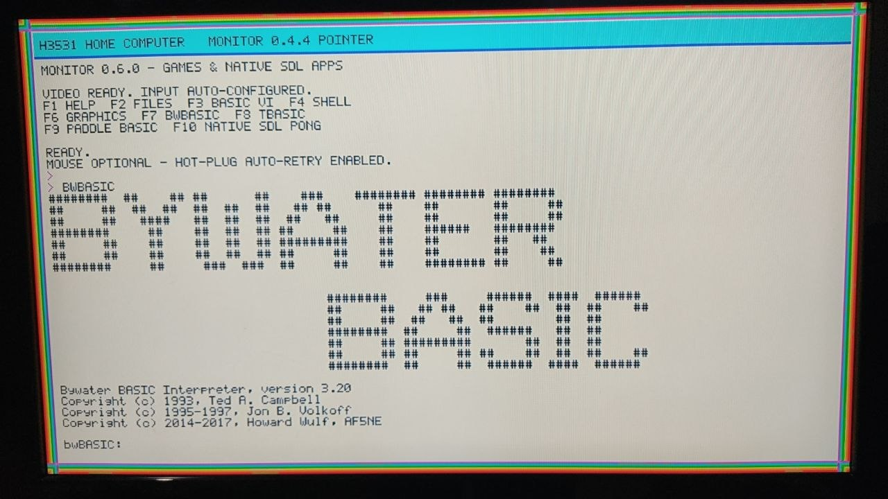
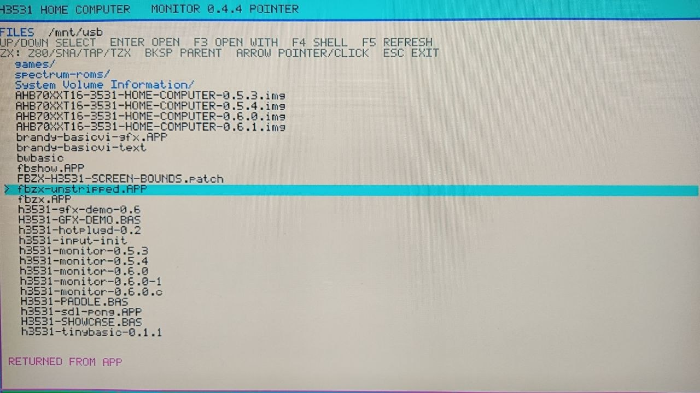
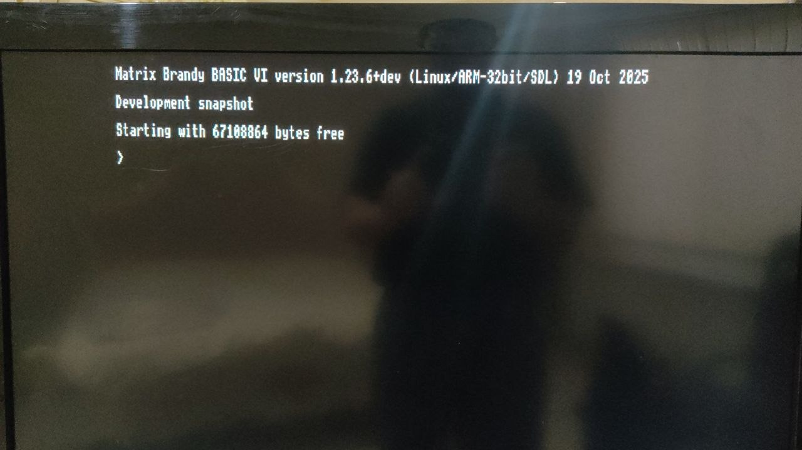
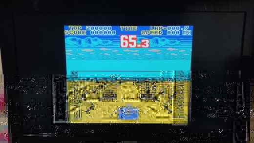
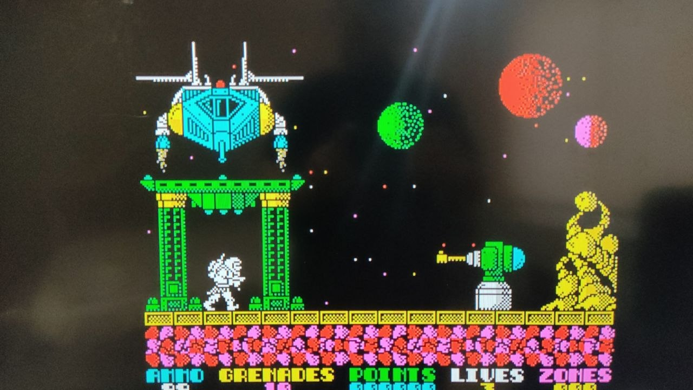
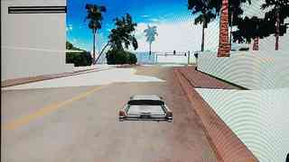

# H3531 Home Computer: как старый видеорегистратор стал экспериментальным домашним компьютером

Попались мне в руки несколько морально устаревших видеорегистраторов. После разборки стало понятно, что внутри находится не просто специализированное DVR-устройство, а полноценная вычислительная платформа.

Плата AHB70XXT16-3531 V2.01 построена вокруг HiSilicon Hi3531. Linux видит два ARMv7-ядра, на плате установлена память, USB, Ethernet, SATA, HDMI, VGA, UART и SPI Flash. По сути это небольшой Linux-компьютер, просто изначально предназначенный для видеонаблюдения.

Мне стало интересно: можно ли перестать относиться к нему как к регистратору и сделать из него самостоятельную экспериментальную компьютерную среду?

Я не являюсь профессиональным разработчиком embedded-систем. Но сегодня у одного человека есть инструмент, которого раньше не было, — искусственный интеллект. Он не заменяет реальные эксперименты: плату всё равно нужно подключать, смотреть UART, проверять изображение, ловить ошибки и снова собирать программы. Но он позволяет быстрее разбираться в загрузчике, Linux, C, framebuffer, SDL и чужом исходном коде. Так появился проект **H3531 Home Computer**.

## Актуальная публичная загрузка

В GitHub Releases сейчас опубликован отдельный архив **StayPlaytion**:

**[Скачать SP.rar (RAR, 179 238 987 байт)](https://github.com/irman100/H3531/releases/download/StayPlaytion/SP.rar)**

Страница публикации: **[H3531 Home Computer StayPlaytion — Public Demo](https://github.com/irman100/H3531/releases/tag/StayPlaytion)**

SHA-256, указанный GitHub для загруженного файла:

    7482100243c552556f08bb8332f4fa65db696ebed73dc799ce0c290314fbebe1

Это архив формата RAR, а не ZIP. GitHub сообщает состояние файла `uploaded`; это подтверждает успешную загрузку вложения, но не заменяет проверку распаковки и тест на реальной плате. Внутренний состав `SP.rar` в этой статье не перечисляется как проверенный.

Первоначальный USB Kit v0.7 и его руководство сохранены в исторической документации. **[Быстрый запуск v0.7](../quickstart-v0.7-fbzx-z80-ru.md)** относится к старому комплекту и не считается инструкцией для `SP.rar` без отдельной проверки структуры нового архива.

## С чего начался путь

Сначала нужно было понять заводскую систему: U-Boot, Linux 3.0.8, SPI Flash, модули HiSilicon и штатное DVR-приложение Sofia. Серия reverse-engineering экспериментов позволила восстановить цепочку видеовывода и доказать, что для собственной картинки на HDMI заводская Sofia не нужна.

Удалось самостоятельно поднять цепочку:

    MPP -> VO -> HDMI -> HIFB -> /dev/fb0

и получить собственное изображение 1280×720 из userspace. После этого устройство уже можно было рассматривать не как DVR, а как самостоятельную Linux-платформу.

## Безопасная система вместо прошивки

Экспериментировать с постоянной SPI Flash мы сознательно не стали. Используется заводское ядро Linux 3.0.8, а собственная система загружается с USB в RAM как внешний CramFS-образ. saveenv не используется, экспериментальные образы в SPI не записываются.

Этот подход позволил много раз менять rootfs, Monitor и программы без риска потерять заводскую систему.

## Monitor, FILES и BASIC

Следующим этапом стал **H3531 Monitor** — собственная оболочка. Сначала это был framebuffer-терминал, затем появились PTY и shell, USB-клавиатура и мышь, история команд, hot-plug, FILES и запуск приложений с флешки.

  
  

В систему были добавлены Tiny BASIC, Bywater BASIC 3.20 и Matrix Brandy BASIC VI. Для графических программ появился собственный SDL 1.2 backend, который преобразует обычную логическую SDL-поверхность в физический 16-bit ARGB1555 framebuffer Hi3531.

Позже жизненный цикл графических программ был переделан на execve(): Monitor освобождает экран и input, приложение получает их эксклюзивно, а после выхода supervisor запускает Monitor заново и восстанавливает состояние FILES.

## Автоматическая загрузка

Для повседневных тестов появился **Boot Kit 0.7** для Windows. Он автоматически перехватывает заводской U-Boot через UART, загружает kernel и H3531.IMG с USB/RAM и остаётся полноценным двунаправленным UART-терминалом.

## Эмуляторы — один из классов приложений

После BASIC и нативных ARM/SDL-программ мы решили проверить ещё один тип стороннего ПО — эмулятор. Первым экспериментом стал FBZX 3.1.0.

  
  

Физически подтверждённый сценарий раннего релиза: **FILES → .Z80 → FBZX → запущенная программа/игра**. Это был важный тест возможностей платформы, но не конечная цель проекта.

## От Monitor к постоянному Desktop

Следующий большой шаг — изменение самой модели работы системы. Вместо завершения и повторного запуска оболочки после каждого полноэкранного приложения появилась постоянная X11/LXDE-сессия.

В Stage 6.6A Desktop включает Xfbdev, Openbox, PCManFM и LXPanel. Сеть поднимается автоматически, а FBZX может открываться обычным X11-окном: пользователь закрывает эмулятор и остаётся на том же рабочем столе с открытыми папками и панелью.

Затем появился application framework с APPINFO.CFG: манифест приложения сообщает системе, как его обнаружить и запустить. Для программ, которым по-прежнему нужен прямой framebuffer, были разработаны Native App Bridge и live framebuffer lease. Они временно передают приложению /dev/fb0, затем восстанавливают режим экрана, alpha, пиксели и input, не уничтожая саму Desktop-сессию.

Это важное архитектурное изменение: Desktop стал постоянной средой, а нативные framebuffer-программы — отдельными приложениями, которые временно получают экран.

## GameFront: отдельная игровая оболочка

Поверх системных приложений появилась игровая оболочка GameFront. Она развивалась от библиотеки игр и медиакарточек до полноценного интерфейса с поиском, избранным, системными настройками и управлением контроллерами.

В более поздних этапах добавлены мастер настройки геймпада, захват осей, обработка событий ввода, горячие клавиши, адаптивные аналоговые оси и более удобная навигация. GameFront не заменяет Desktop: это отдельный интерфейс для запуска игровых систем и приложений.

## Больше портов: NES, RetroArch и офисные приложения

Эксперименты вышли за пределы одного ZX Spectrum:

- Nofrendo v11.1 — отдельный NES-порт с собственным видеопутём HIFB и аудиобэкендом платы;
- RetroArch — ARM/HIFB-адаптация и несколько libretro core experiments, включая FCEUmm, PicoDrive, PCSX-ReARMed и Stella 2014;
- SIAG Office — сборка офисного пакета под ARM;
- Space3D и Flight Core — нативные графические эксперименты, позволяющие проверять ввод, тайминг, framebuffer и производительность.

Степень готовности у этих портов разная: успешная сборка и CI — только один из этапов, после которого ещё нужна проверка на самом Hi3531.

## Нативный 3D Racer и мир Vice City

Самое амбициозное направление — собственный лёгкий 3D Racer для Hi3531. Мы не стали переносить весь reVC целиком. Вместо этого разбираем нужные архитектурные механизмы GTA Vice City и реализуем их в компактном движке, который может работать на двух Cortex-A9 без обычного 3D GPU.

Для локального импорта используются оригинальные структуры ресурсов игры: IDE/IPL, DFF, TXD/TXDP и COL. Мир собирается в отдельные страницы и подгружается вокруг автомобиля. Для объектов сохраняются atomic LOD и исходные дистанции, чтобы переключать целый объект между уровнями детализации, а не растворять отдельные треугольники.

В движке появились собственные world streaming, collision, vehicle suspension и wheel-force системы. Характеристики машины берутся из локального handling.cfg, а типы поверхности — из surface.dat. Для аудио разработан отдельный HiSilicon AO backend; игровые SFX и радиостанции импортируются локально из пользовательской установки Vice City.

  

Это **экспериментальный портовый проект, а не готовая Vice City**. Полный игровой цикл, физика автомобиля и производительность всё ещё требуют аппаратной доводки. В репозитории нет игровых моделей, текстур, collision-файлов, музыки или других проприетарных данных Rockstar: локальный импортёр работает с копией игры пользователя и создаёт локальные файлы сборки.

## Из чего состоит H3531 Home Computer сейчас

    HiSilicon Hi3531 / ARMv7
             |
        Linux 3.0.8
             |
      USB/RAM Stayplaytion system
             |
      session / app supervisor
             |
      persistent X11 / LXDE Desktop
             |
      +------+-----------+----------------+
      |                  |                |
    GameFront        Desktop apps     Native App Bridge
      |                  |                |
    RetroArch        SIAG Office      framebuffer apps
    Nofrendo         utilities        Racer / demos
    FBZX

Отдельно развивается Stage 6.8 firmware/POST prototype: он исследует раннюю диагностику платы, выбор загрузочного устройства и внешний OS rootfs. Это пока прототип архитектуры, а не замена заводского U-Boot. Базовое правило безопасности остаётся прежним: не использовать saveenv и не записывать экспериментальные образы в SPI Flash.

## Что опубликовано, а что ещё развивается

Публичный prerelease **v0.7** был первым воспроизводимым комплектом проекта: Monitor, FILES, BASIC, SDL и FBZX. Его старый release-тег и ZIP больше не доступны по прежним адресам. Текущая ссылка на публичную загрузку ведёт на отдельный релиз **StayPlaytion** с архивом `SP.rar`. Содержимое нового архива нужно оценивать по самому файлу после распаковки; историческое описание v0.7 не следует считать перечнем содержимого `SP.rar`.

Racer особенно важно считать незавершённым: CI помогает проверять сборку и регрессии, но не подтверждает корректное поведение автомобиля на реальной плате. Мы продолжаем сверять физику, ввод, звук и производительность по аппаратным логам.

## Продолжение

- [Скачать актуальный архив StayPlaytion — SP.rar](https://github.com/irman100/H3531/releases/download/StayPlaytion/SP.rar)
- [Страница релиза StayPlaytion](https://github.com/irman100/H3531/releases/tag/StayPlaytion)
- [Архивная инструкция быстрого запуска v0.7](../quickstart-v0.7-fbzx-z80-ru.md) — только для прежнего USB Kit
- [Техническая документация v3](../AHB70XXT16-3531_Hi3531_Technical_Documentation_RU_v3.docx)
- [Актуальная ветка разработки](https://github.com/irman100/H3531/tree/feature/h3531-stage68-desktop-input-polish)
- [Desktop README](../../ports/stage66a/README.md)
- [GameFront README](../../ports/frontend/README.md)
- [Racer README](../../ports/racer/README.md)
